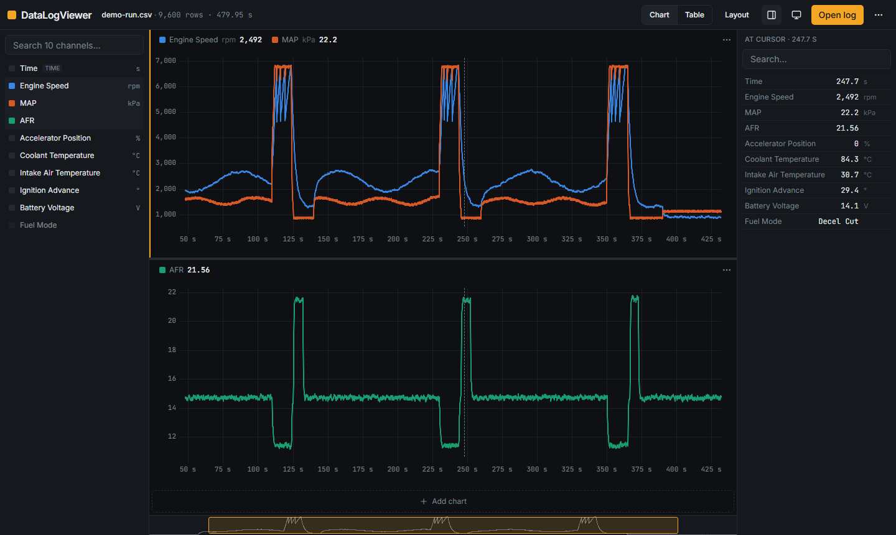

# DataLogViewer

Free, fast datalog viewer for CSV logs, right in your browser.

**Open it:** https://elvisokereke.github.io/datalogviewer/



- **Private.** Your log files never leave your computer: no server, no account, no tracking.
- **Fast.** A 1,000,000-row log loads in about two seconds and zooms and pans smoothly.
- **Forgiving.** Handles comma, semicolon and tab files, decimal commas, units rows, preambles, placeholders and messy spreadsheet exports.

## Features

- Stacked charts with a crosshair shared across every chart; each channel gets its own scale.
- Mouse-wheel zoom, drag to pan, double-click to see the whole log.
- Click to pin the cursor, then step through samples with the arrow keys.
- Overview strip of the whole log with a draggable window.
- Searchable channel list: click or drag a channel onto a chart.
- Inspector panel with every channel's value at the cursor, and a table view of the raw data.
- Your layout is remembered and reconnects to channels by name when you open the next log.
- **Calculated channels** from formulas like `[AFR] / 14.7` or `smooth([MAP], 5)`, with live validation.
- **Range statistics:** Shift+drag to select a stretch of the log and see min / mean / max / std for every channel; Z zooms to it.
- **Markers:** press M to mark a moment; markers are listed, renamable and come back when you reopen the file.
- **Layout files:** save your charts and calculated channels to a file and share them.
- **Scatter plots** of any two channels, optionally coloured by a third, over the view, a selection or the whole log.
- **Export** the visible range or selection as CSV, and the charts or scatter plot as a PNG image.
- Dark and light themes; works on phones with touch gestures.

Press <kbd>?</kbd> in the app for all keyboard shortcuts.

## Roadmap

- **v0.2, analyst (done):** calculated channels, range stats, markers, layout files, scatter plots, PNG/CSV export.
- **v0.3+, MegaLogViewer rival:** RPM × MAP tables, log comparison, filters, more formats, offline install.

## Feedback

Found a file it can't read? [Open an issue](https://github.com/ElvisOkereke/datalogviewer/issues).

## Development

Requires Node 22+.

```bash
npm install
npm run dev        # http://localhost:5173/datalogviewer/
npm test           # unit tests
npm run test:e2e   # end-to-end tests (builds first)
npm run sample     # regenerate public/samples/demo-run.csv
```

The original Flutter prototype is preserved at the `flutter-prototype` tag.

Free to use. © 2026 Elvis Okereke.
